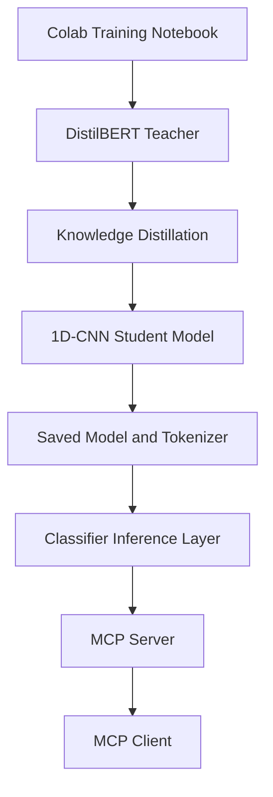
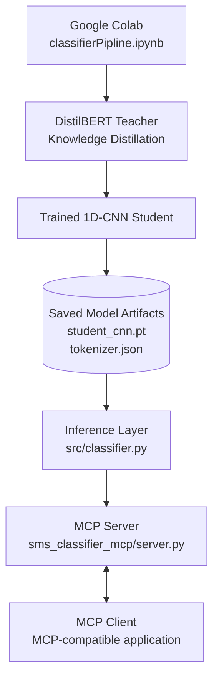

# SMS Promotional vs Transactional Classifier

A lightweight SMS text classification project that uses a distilled 1D-CNN student model to classify messages as **promotional** or **transactional**. The project exposes model inference through the Model Context Protocol (MCP), allowing compatible MCP clients to request predictions.

## Overview

The model-development workflow uses a DistilBERT teacher model and knowledge distillation to train a smaller 1D-CNN student model.

The Colab notebook contains the training and evaluation workflow. The saved student checkpoint and tokenizer are used by the local inference implementation, while the MCP server exposes classification functionality to compatible clients.

### Classification labels

- `promotional`
- `transactional`

## Architecture



The MCP server calls the inference layer. It does not train the model when a client requests a prediction.

## Project Structure

```text
sms-classifier-mcp/
├── classifierPipline.ipynb
├── model/
│   ├── student_cnn.pt
│   ├── tokenizer.json
│   └── tokenizer_config.json
├── src/
│   ├── __init__.py
│   └── classifier.py
├── sms_classifier_mcp/
│   ├── __init__.py
│   └── server.py
├── tests/
├── docs/
├── requirements.txt
├── README.md
└── .gitignore
```

The `tests/` and `docs/` directories will contain automated tests and project documentation as they are added.

## System Architecture

The project separates model training, model inference, and MCP tool execution into independent components. The model is trained in Google Colab, and the saved student model and tokenizer are loaded by the local inference layer. The MCP server exposes the classification functionality to MCP-compatible applications.

### Architecture Diagram



### Component Responsibilities

| Component           | File or Location                    | Responsibility                                                                                                            |
| ------------------- | ----------------------------------- | ------------------------------------------------------------------------------------------------------------------------- |
| Training pipeline   | `classifierPipline.ipynb`           | Trains the DistilBERT teacher, performs knowledge distillation, evaluates the student model, and exports model artifacts. |
| Saved student model | `model/student_cnn.pt`              | Stores the trained 1D-CNN model weights.                                                                                  |
| Tokenizer           | `model/tokenizer.json`              | Converts input SMS text into token IDs for inference.                                                                     |
| Inference layer     | `src/classifier.py`                 | Loads the model and tokenizer, processes SMS messages, and returns predictions and probabilities.                         |
| MCP server          | `sms_classifier_mcp/server.py`      | Exposes inference functionality through MCP tools.                                                                        |
| MCP client          | External MCP-compatible application | Connects to the MCP server and invokes its available tools.                                                               |

### Available MCP Tools

The server is intended to expose the following tools:

- **`classify_sms(message)`** — classifies a single SMS message.
- **`classify_batch(messages)`** — classifies multiple SMS messages.
- **`get_model_info()`** — returns information about the loaded model.

### Inference Workflow

1. An MCP client invokes a classification tool with an SMS message.
2. The MCP server validates the request and calls the inference layer.
3. The tokenizer converts the message into model input tensors.
4. The trained 1D-CNN student model generates prediction scores.
5. The inference layer returns the predicted category and probabilities.
6. The MCP server returns the result to the client.

### Training and Inference Separation

Model training and inference are separate workflows. The Colab notebook is used to train and evaluate the model. The MCP server loads the saved model artifacts and performs inference without retraining the model for each request.

## Requirements

- Python 3.10 or a compatible version supported by the selected dependencies
- PyTorch
- Hugging Face Tokenizers
- MCP Python SDK
- Additional dependencies listed in `requirements.txt`

## Installation

Clone the repository and open a terminal in its root directory.

```bash
git clone https://github.com/G-Supun/colab-notebooks_Classification.git
cd colab-notebooks_Classification
```

Create and activate a virtual environment.

Windows PowerShell:

```powershell
python -m venv .venv
.\.venv\Scripts\Activate.ps1
```

Install the dependencies:

```powershell
python -m pip install --upgrade pip
pip install -r requirements.txt
```

## Run the Classifier

The inference implementation loads the saved student model and tokenizer.

Run this smoke test from the repository root:

```powershell
python -c "from src.classifier import SMSClassifier; c = SMSClassifier('model'); print(c.classify('Your package will be delivered tomorrow')); print(c.model_info())"
```

This command assumes the classifier exposes the `SMSClassifier` class, `classify()` method, and `model_info()` method. If those names differ in the final implementation, update the example to match the actual API.

## Run the MCP Server

Start the server from the repository root:

```powershell
python -m sms_classifier_mcp.server
```

The server uses the MCP standard input/output (`stdio`) transport. An MCP-compatible client must connect to it to invoke tools; starting the process alone does not demonstrate that the tools work.

## MCP Tools

The intended server interface exposes these tools:

| Tool             | Purpose                                    |
| ---------------- | ------------------------------------------ |
| `classify_sms`   | Classify one SMS message.                  |
| `classify_batch` | Classify multiple SMS messages.            |
| `get_model_info` | Return information about the loaded model. |

The returned label and probabilities should be generated by the saved model. They must not be hardcoded.

## Testing

Automated tests will be added under `tests/`.

Once the test suite is available, run:

```powershell
python -m pytest -v
```

Test coverage should include model loading, valid and invalid inputs, single-message inference, batch inference, and MCP tool calls.

## Evaluation

Evaluation metrics should be reported from the notebook's actual held-out evaluation results. Before publishing accuracy, precision, recall, F1 score, confusion matrices, or inference benchmarks, confirm the dataset split and measurement procedure used for each result.

## Limitations

- Predictions depend on the training data and learned model parameters.
- Classification output is a model prediction, not a guarantee that a message is correctly categorized.
- The local MCP server must be running and accessible to the MCP client.
- Reproducing training may require additional compute and data that are not included in the repository.

## Future Improvements

- Add automated classifier and MCP tests.
- Document the final evaluation results and confusion matrix.
- Benchmark CPU inference and compare PyTorch with ONNX Runtime.
- Add reproducible environment configuration and model-version information.

## Supervisors

### Company Supervisor

- Name: Mr. Vishwa Mahanama
- Organization: Adeona Technologies
- Responsibilities:
  - Evaluate project progress
  - Review major updates
  - Approve deployments
